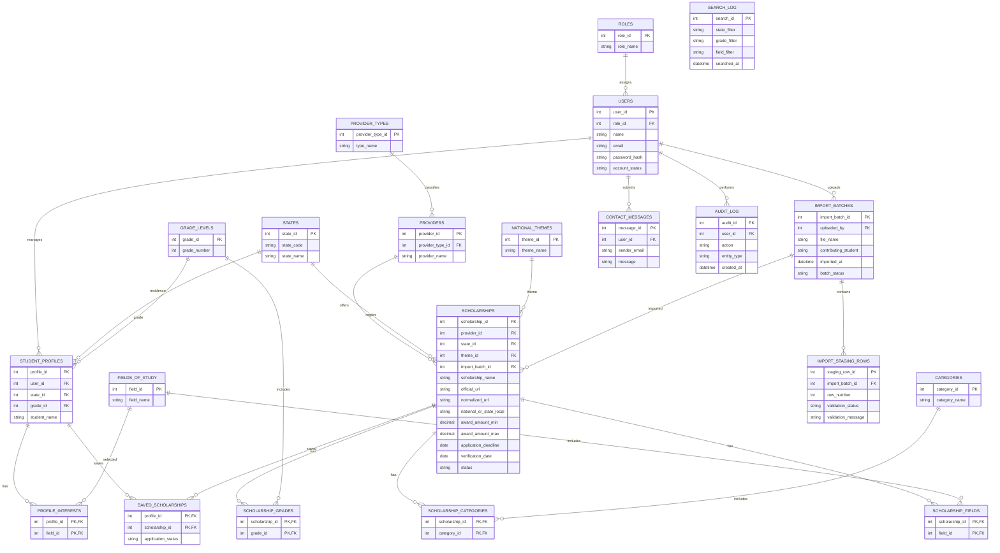

# Pathways to Scholarships — Entity-Relationship Diagram

## Iteration 1 — Database Design

This ERD represents the database structure planned for the
Pathways to Scholarships application.

## Design Notes

- Primary keys uniquely identify records.
- Foreign keys connect related tables.
- A provider can offer multiple scholarships.
- Scholarships can have multiple grades, categories, and fields of study.
- Students and parents can maintain scholarship profiles.
- Saved scholarships belong to individual profiles.
- Uploaded scholarship files are recorded as import batches.
- Uploaded rows are staged before entering the live scholarship table.
- Audit records track important administrative actions.
- The complete scholarship fields from Section 6.1 will be included in the Iteration 2 database schema.
